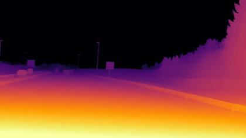
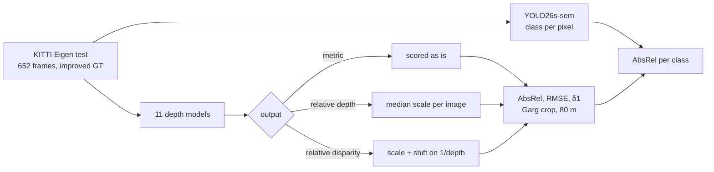

# Monocular depth on KITTI

How far away is the guard rail, from one camera? Eleven depth models from four families,
from a 2026 real-time YOLO to 2025 foundation models, evaluated under one protocol on the
KITTI Eigen test split, with the published numbers next to mine and the error broken down by
what the pixel shows (road, car, pole, fence, sign). Relative models are aligned per image the
way their authors evaluate them; metric models are scored as they come, which is the point of
metric depth. On top, the real-time YOLO26s-depth is fine-tuned on KITTI into a metric model:
it becomes the most accurate metric model of the benchmark.

<p align="center"></p>



## Highlights

- **A real-time metric model.** Fine-tuned on KITTI, YOLO26s-depth reaches AbsRel 0.075 and
  δ1 0.932 in metres, with no per-image alignment: better than every metric foundation model
  here (Depth Anything 3 Metric-Large 0.099, Depth Pro 0.118), and after median alignment level
  with Depth Anything V2-Large (0.070), at 0.02 s per image against 1.35 s.
- **Published numbers reproduced.** Depth Anything V2 reaches AbsRel 0.070 / δ1 0.956 (paper:
  0.074 / 0.946), YOLO26-depth δ1 0.887 / 0.918 / 0.937 for s / m / x (Ultralytics: 0.879 /
  0.913 / 0.932).
- **Input geometry matters for YOLO26-depth.** The models are trained on frames stretched to a
  768 x 768 square, and every YOLO26-depth number here is predicted the same way. A
  letterboxed frame, which keeps KITTI's 3.3:1 aspect ratio, is an input the model has never
  seen and costs about 0.24 in δ1 (table below). The fine-tuning keeps the same geometry.
- **Metric depth without any alignment.** Depth Anything 3 Metric-Large reaches AbsRel 0.099
  with no per-image scaling, from the camera's focal length alone.
- **Depth Pro has the best shape, not the best scale.** Aligned by the median it is the best of
  all models (AbsRel 0.060, δ1 0.963), but its metric output depends on its own estimate of the
  focal length: AbsRel 0.141 as published, 0.118 when the depth is rescaled with KITTI's true
  focal length.
- **Thin structures are the hard part.** For every model the error on poles, signs and fences
  is two to four times the error on the road surface. Road inspection measures exactly those.

## Results

KITTI Eigen test split: 652 of the 697 frames have the improved ground truth (Uhrig et al.,
3DV 2017) and are used here. Garg crop, depth range 0.001-80 m, metrics per image and averaged.
Seconds per image on an Apple M4 Pro GPU.

| Model | Year | Output | Alignment | AbsRel ↓ | RMSE (m) ↓ | δ1 ↑ | Published: AbsRel / δ1 | s/image |
|---|---|---|---|---|---|---|---|---|
| Depth Anything V2-Large | 2024 | disparity | scale + shift | **0.070** | **3.10** | **0.956** | 0.074 / 0.946 | 1.35 |
| **YOLO26s-depth, fine-tuned on KITTI (this repo)** | 2026 | metric | **none** | 0.075 | 3.18 | 0.932 | - | 0.02 |
| YOLO26x-depth | 2026 | depth | median | 0.075 | 3.19 | 0.937 | - / 0.932 | 0.08 |
| Depth Anything V2-Small | 2024 | disparity | scale + shift | 0.077 | 3.46 | 0.944 | 0.078 / 0.936 | 0.18 |
| YOLO26m-depth | 2026 | depth | median | 0.086 | 3.64 | 0.918 | - / 0.913 | 0.04 |
| Depth Anything 3 Metric-Large | 2025 | metric | none | 0.099 | 3.39 | 0.918 | - | 0.13 |
| YOLO26s-depth | 2026 | depth | median | 0.105 | 3.95 | 0.887 | - / 0.879 | 0.02 |
| Depth Anything 3 Mono-Large | 2025 | depth | median | 0.106 | 3.69 | 0.891 | - | 0.12 |
| Depth Pro, true focal length | 2024 | metric | none | 0.118 | 3.63 | 0.848 | - | 5.15 |
| Depth Anything V2-Metric-Outdoor-Small | 2024 | metric | none | 0.128 | 4.46 | 0.828 | - | 0.18 |
| Depth Anything V2-Metric-Outdoor-Large | 2024 | metric | none | 0.136 | 3.70 | 0.839 | - | 1.97 |
| Depth Pro | 2024 | metric | none | 0.141 | 3.38 | 0.835 | - | 5.15 |

Published numbers: Yang et al. (Depth Anything V2), Table 2 (KITTI, zero-shot, scale and
shift on disparity); YOLO26-depth from the Ultralytics KITTI dataset page (652 frames, improved
ground truth, median alignment, 80 m cap). Ultralytics notes that the released YOLO26-depth
weights were trained on a split that contained 72 of these test frames, so its rows are not
strictly zero-shot. Depth Anything 3 and Depth Pro publish no number for this protocol.

**Metric models, shape against scale** (the same predictions, median-aligned per image):

| Model | AbsRel as published | AbsRel, median-aligned | δ1, median-aligned |
|---|---|---|---|
| Depth Pro | 0.141 | **0.060** | **0.963** |
| YOLO26s-depth, fine-tuned on KITTI | **0.075** | 0.070 | 0.942 |
| Depth Anything 3 Metric-Large | 0.099 | 0.065 | 0.956 |
| Depth Anything V2-Metric-Outdoor-Large | 0.136 | 0.095 | 0.918 |
| Depth Anything V2-Metric-Outdoor-Small | 0.128 | 0.114 | 0.866 |

Most of Depth Pro's error is one scale factor per image, which comes from its focal-length
estimate. With a calibrated camera part of it can be corrected: AbsRel falls from 0.141 to
0.118, still twice the median-aligned 0.060. The Depth Anything V2 metric models are
fine-tuned on Virtual KITTI 2, a synthetic copy of KITTI's scenes, and still lose to Depth
Anything 3.

**AbsRel by object class** (pixels labelled by YOLO26s-sem, a Cityscapes model):

| Model | road | car | fence | pole | traffic sign | vegetation | building |
|---|---|---|---|---|---|---|---|
| YOLO26s-depth, fine-tuned (metric, no alignment) | **0.040** | **0.074** | 0.136 | 0.130 | 0.190 | 0.145 | 0.110 |
| Depth Anything V2-Large | 0.044 | 0.076 | **0.095** | **0.126** | **0.156** | **0.124** | **0.095** |
| YOLO26x-depth | 0.047 | 0.081 | 0.103 | 0.151 | 0.207 | 0.131 | 0.102 |
| Depth Anything 3 Metric-Large | 0.081 | 0.108 | 0.110 | 0.147 | 0.185 | 0.146 | 0.103 |
| Depth Pro, true focal length | 0.105 | 0.098 | 0.155 | 0.140 | 0.172 | 0.161 | 0.122 |
| YOLO26s-depth | 0.064 | 0.129 | 0.160 | 0.238 | 0.313 | 0.177 | 0.137 |

Signs and poles are thin and stand in front of distant background: a few pixels of blur at
their edge mix two depths. The metric models are flatter across classes than the aligned ones,
because their dominant error is the global scale.

**YOLO26-depth input geometry** (δ1, median alignment):

| Input to `predict()` | YOLO26s | YOLO26m | YOLO26x |
|---|---|---|---|
| letterboxed (Ultralytics' default for prediction) | 0.646 | 0.672 | 0.696 |
| stretched to 768 x 768 (as in training and validation) | **0.887** | **0.918** | **0.937** |

## Quickstart

```bash
pip install -e ".[train]"
bash scripts/download_data.sh            # the 652 frames out of KITTI raw + annotations, ~0.7 GB via range requests
depth-benchmark --models da2-small yolo26s-depth da3-metric-large --root data/kitti_eigen --out runs/benchmark --by-class
depth-summary --runs runs/benchmark
```

Depth Anything 3 needs its own package (`bash scripts/install_da3.sh`). The KITTI frames and
the annotation PNGs are read directly out of the large KITTI archives with HTTP range requests.

## Running on a Slurm cluster

```bash
bash scripts/setup_cluster.sh && bash scripts/download_data.sh && bash scripts/download_models.sh
python3 slurm/generate.py benchmark --submit          # all models, array of four groups
bash scripts/download_kitti_depth_train.sh            # login node: Eigen train for fine-tuning
python3 slurm/generate.py finetune-yolo --submit      # YOLO26s-depth on KITTI, 10 epochs (mono_depth.finetune)
python3 slurm/generate.py eval-finetuned --submit
python3 slurm/generate.py summary --submit
```

The fine-tuning job (`mono_depth.finetune`) trains YOLO26s-depth for 10 epochs on the Eigen
training drives, with the same stretched input as validation and prediction. Every 12th
training drive is held out: it selects the checkpoint and fits the output scale that makes the
prediction metric, so the 652 test frames are used only for the final score.

## Project layout

```
src/mono_depth/
  datasets/kitti_eigen.py   Eigen split, improved ground truth, focal lengths; range-request download
  remote_zip.py             members of remote ZIP archives over HTTP range requests
  models.py                 YOLO26-depth, Depth Anything V2 / 3, Depth Pro behind one call
  metrics.py                masks, the four alignments, per-image metrics, per-class AbsRel
  benchmark.py              evaluation loop, class labels from YOLO26s-sem; summary.py: tables
tests/                      metrics and alignments on synthetic scenes, the loader, the benchmark loop
```

## Design notes

- **One alignment per output type.** Disparity models (Depth Anything V2) are aligned with a
  scale and a shift in inverse depth, as in their paper; relative depth with a median scale, as
  in Ultralytics' and Monodepth2's evaluation; metric models not at all. A fourth mode,
  affine in log depth, is reported in the JSON files only: it also undoes a compressed depth
  range and flatters such models (YOLO26s-depth letterboxed: δ1 0.646 median, 0.786 log).
- **Depth Anything 3's metric scale** follows its README: the network predicts depth for a
  canonical focal length of 300 px at its processing resolution, and the output is multiplied
  by the true focal length (scaled to that resolution) over 300.
- **Not included:** ZoeDepth. Its Hugging Face configuration for the KITTI checkpoint uses the
  NYU depth bins; even with that patched, AbsRel stayed at 0.155-0.19 against the published
  0.054, so the row would have measured the port rather than the model.

## References

- L. Yang et al., *Depth Anything V2*, NeurIPS 2024.
- H. Lin et al., *Depth Anything 3: Recovering the Visual Space from Any Views*, 2025.
- A. Bochkovskii et al., *Depth Pro: Sharp Monocular Metric Depth in Less Than a Second*, ICLR 2025.
- Ultralytics YOLO26 depth: https://docs.ultralytics.com/tasks/depth/, https://docs.ultralytics.com/datasets/depth/kitti/.
- D. Eigen, C. Puhrsch, R. Fergus, *Depth Map Prediction from a Single Image using a Multi-Scale Deep Network*, NeurIPS 2014.
- R. Garg et al., *Unsupervised CNN for Single View Depth Estimation: Geometry to the Rescue*, ECCV 2016.
- J. Uhrig et al., *Sparsity Invariant CNNs*, 3DV 2017 (improved ground truth).
